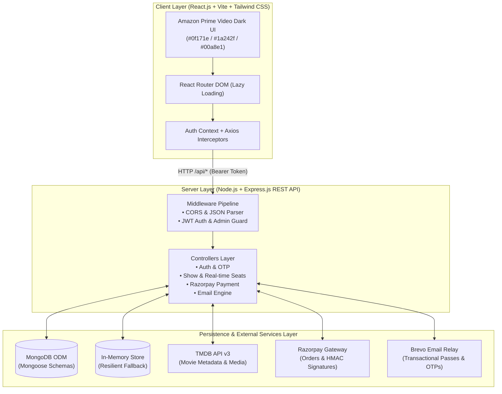
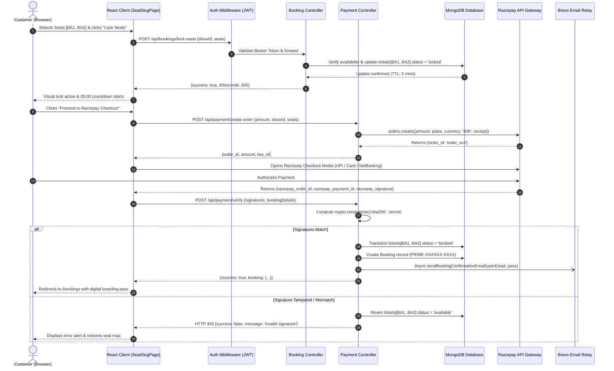

# 🏛️ System Architecture & MVC Implementation

This document provides a comprehensive architectural blueprint of the **iMovies** movie ticket booking platform. It details the **Model-View-Controller (MVC)** design pattern, data flow, component hierarchies, database design, and end-to-end request lifecycles.

---

## 🏗️ High-Level System Overview



---

## 🧩 1. The Model Layer (Data & State Management)

The Model layer defines database schemas, business rules, relationships, data validation, and persistence strategies. It is implemented with **Mongoose ODM** with an automated dual-engine fallback to an in-memory database store (`memoryStore.js`) if MongoDB is offline.

### Mongoose Schemas (`server/src/models/`)

1. **User Model (`userModel.js`)**:
   - Manages viewer accounts, authentication credentials, and email verification states.
   - **Key Attributes**: `username` (unique, 3–20 chars), `email` (unique, lowercase), `password` (bcrypt hash, min 6 chars), `role` (`'user'`).
   - **Verification & Recovery Attributes**: `isVerified` (Boolean), `verificationOTP` (6-digit string), `verificationToken`, `otpExpires` (15-min TTL), `resetPasswordOTP`, `resetPasswordToken`, `resetPasswordExpires`.

2. **Admin Model (`adminModel.js`)**:
   - Dedicated administrative accounts with elevated privileges for managing movies, theatres, and schedules.
   - **Key Attributes**: `username`, `email`, `password`, `role` (`'admin'`).

3. **Movie Model (`movieModel.js`)**:
   - Cinema release catalog enriched with metadata.
   - **Key Attributes**: `movieName`, `description`, `genres` (Array of Strings), `releaseDate`, `language`, `duration`, `certification` (e.g. "U/A", "R"), `posterUrl`, `backdropUrl`, `trailerUrl`, `rating`.

4. **Theatre Model (`theatreModel.js`)**:
   - Physical multiplexes and tier pricing configurations.
   - **Key Attributes**: `theatreName`, `location`, `balconySeatPrice` (Tier 1), `middleSeatPrice` (Tier 2), `lowerSeatPrice` (Tier 3), `balconySeats`, `middleSeats`, `lowerSeats`.

5. **Show Model (`showModel.js`)**:
   - Scheduled screening instance linking a movie to a theatre at a specific date and time.
   - **Key Attributes**: `showId`, `adminEmail`, `movieId`, `movieName`, `theatreName`, `location`, `showDate`, `showTime`, `screenType` ("IMAX Laser 3D", "Dolby Atmos 4K"), `pricing` (balcony, middle, lower).
   - **Real-Time Seat Map (`tickets`)**: Key-value dictionary tracking status (`available`, `locked`, `booked`), lock ownership (`lockedBy`), and expiration timestamp (`lockedUntil`).

6. **Booking Model (`bookingModel.js`)**:
   - Confirmed reservation pass.
   - **Key Attributes**: `bookingId` (`PRIME-XXXXXX-XXXX`), `userEmail`, `showId`, `movieName`, `theatreName`, `location`, `showDate`, `showTime`, `selectedSeats`, `seatDetails` (array of seat, tier, price), `totalAmount`, `paymentStatus` ("Completed", "Pending", "Cancelled"), `paymentMethod` ("Razorpay", "Prime Cinema Pay"), `razorpayOrderId`, `razorpayPaymentId`, `razorpaySignature`.

7. **Favorite Model (`favoriteModel.js`)** & **Review Model (`reviewModel.js`)**:
   - Manages user watchlists and 1–10 star ratings with textual reviews.

### Real-Time TTL Watchdog Engine (`server/src/utils/ttlCleaner.js`)
- Runs a 15-second background interval loop.
- Scans all active shows and releases any seat where `lockedUntil < Date.now()` back to `"available"`, preventing abandoned checkout deadlocks.

---

## 🖥️ 2. The View Layer (Client & API Responses)

In a decoupled full-stack architecture, the View layer spans both frontend user interfaces and structured backend API response representations.

### Client-Side Views (`client/src/pages/`)
Implemented with **React.js**, **React Router DOM (Lazy Loaded)**, and styled using the **Amazon Prime Video Dark Aesthetic** (`#0f171e` deep obsidian backgrounds, `#1a242f` surface cards, crisp white typography, and `#00a8e1` vibrant cyan highlights):

- **`/landing` (`LandingPage.jsx`)**: Prime hero billboard carousel with backdrop scale transitions and authentication entry points.
- **`/login` & `/register` (`LoginPage.jsx`, `RegisterPage.jsx`)**: Dark authentication forms with OTP validation triggers.
- **`/home` (`HomePage.jsx`)**: Prime layout with horizontal category carousels, genre filters, and TMDB live search.
- **`/moviedetails/:movieId` (`MovieDetailsPage.jsx`)**: Cinematic backdrop banner, trailer modal embed, actor avatars, and audience feedback.
- **`/movieshows/:movieId` (`MovieShowsPage.jsx`)**: Multi-day calendar tabs and multiplex screening slots.
- **`/seatslug/:showId` (`SeatSlugPage.jsx`)**: Interactive tiered seat selector (Balcony, Middle, Lower) with color-coded live states and 5-minute countdown checkout dock.
- **`/bookings` (`BookingsPage.jsx`)**: Perforated cinema pass summary cards, print-ready ticket modals, and cancellation tools.
- **`/admin` (`AdminDashboard.jsx`)**: Live revenue analytics, booking logs, and cinema catalog management forms.

### Standardized API JSON View Envelopes
All API endpoints deliver predictable JSON structures with semantic HTTP status codes:

**Success Response:**
```json
{
  "success": true,
  "message": "Operation completed successfully",
  "data": { ... }
}
```

**Error / Conflict Response:**
```json
{
  "success": false,
  "message": "Seat BA1 is temporarily locked by another customer",
  "conflicts": [ "BA1" ]
}
```

| HTTP Status | Semantic Usage |
| :--- | :--- |
| `200 OK` | Successful query or state mutation. |
| `201 Created` | Successful entity creation (e.g. user registered, booking created). |
| `400 Bad Request` | Malformed inputs, expired OTPs, or invalid payment signatures. |
| `401 Unauthorized` | Missing or invalid JWT session token. |
| `403 Forbidden` | Insufficient permissions (e.g. non-admin accessing admin route, unverified email). |
| `404 Not Found` | Requested movie, show, or booking does not exist. |
| `409 Conflict` | Seat already booked or held under an active 5-minute lock. |
| `500 Server Error` | Unexpected backend or third-party service exception. |

---

## 🎮 3. The Controller Layer (Business Logic Orchestration)

Controllers in `server/src/controllers/` encapsulate domain logic, sanitize inputs, coordinate model queries, and interface with external services.

```
server/src/controllers/
├── authController.js       # Register, login, JWT issuance, OTP generation & validation, password reset
├── movieController.js      # Movie catalog retrieval, search debounce, genre filtering, admin publishing
├── theatreController.js    # Theatre venue creation, listing, tier pricing
├── showController.js       # Showtime scheduling, seat map provisioning, show lookup
├── bookingController.js    # Seat locking (TTL), unlock, 1-Click checkout, ticket history, cancellations
├── paymentController.js    # Razorpay order generation, HMAC-SHA256 signature verification, seat transitions
├── emailController.js      # Brevo test dispatch, transactional triggers, service status
├── reviewController.js     # Audience star rating and review submissions
└── favoriteController.js   # Prime watchlist toggle and collection retrieval
```

### Key Controller Workflows

#### 1. Authentication & OTP Controller (`authController.js`)
- Enforces mandatory email verification before allowing user login.
- Generates 6-digit random numeric codes with a 15-minute TTL.
- Calls `emailService.sendVerificationEmail()` asynchronously upon registration.
- Prevents unverified users from signing in (`403 Forbidden` with `isUnverified: true`), instantly dispatching a fresh OTP.

#### 2. Seat Locking Controller (`bookingController.js` -> `lockSeats`)
- Validates that none of the requested seats are already `"booked"`.
- Checks that no active lock exists from another user (`lockedBy !== userEmail` with `lockedUntil > Date.now()`).
- Atomically locks seats for 5 minutes (`300000ms`), assigning `lockedBy = userEmail`.

#### 3. Payment Verification Controller (`paymentController.js` -> `verifyPayment`)
- Recomputes HMAC-SHA256 signature:
  $$\text{Expected} = \text{HMAC-SHA256}(\text{razorpay\_order\_id} + "|" + \text{razorpay\_payment\_id},\, \text{RAZORPAY\_KEY\_SECRET})$$
- **On Match**: Changes ticket states from `"locked"` to `"booked"`, creates the `Booking` document, and dispatches the digital ticket pass via Brevo.
- **On Mismatch**: Returns `400 Bad Request` and releases the locked seats back to `"available"`.

---

## 🔄 4. Request Lifecycle & End-to-End Data Flow

The following sequence diagram details the full request lifecycle during the critical ticket booking and payment verification process:



---

## 🛡️ 5. Security, Resilience & Fallback Architecture

1. **Stateless JWT Authentication**:
   - Issued upon verified login with a 7-day expiration.
   - Verified on all protected user routes (`verifyToken`) and admin panels (`verifyAdmin`).

2. **Cryptographic Password Security**:
   - Passwords hashed using `bcryptjs` with salt work factor of 10.
   - Raw passwords are never persisted or returned in API responses.

3. **Tamper-Proof Payment Verification**:
   - Client-side payment authorization is never blindly trusted.
   - Orders are verified via HMAC-SHA256 server digests before seats transition to `"booked"`.

4. **Multi-Key Email Resiliency**:
   - The email engine (`emailService.js`) initializes the official `@getbrevo/brevo` SDK.
   - If SDK network calls encounter issues, it automatically falls back to direct REST endpoints (`https://api.brevo.com/v3/smtp/email`) with primary and secondary key failover.

5. **Dual Database Failover**:
   - If MongoDB Atlas or local `mongod` is unreachable, `db.js` gracefully switches to an in-memory datastore (`memoryStore.js`).
   - All core operations (browsing, seat locking, bookings, auth) continue uninterrupted.
