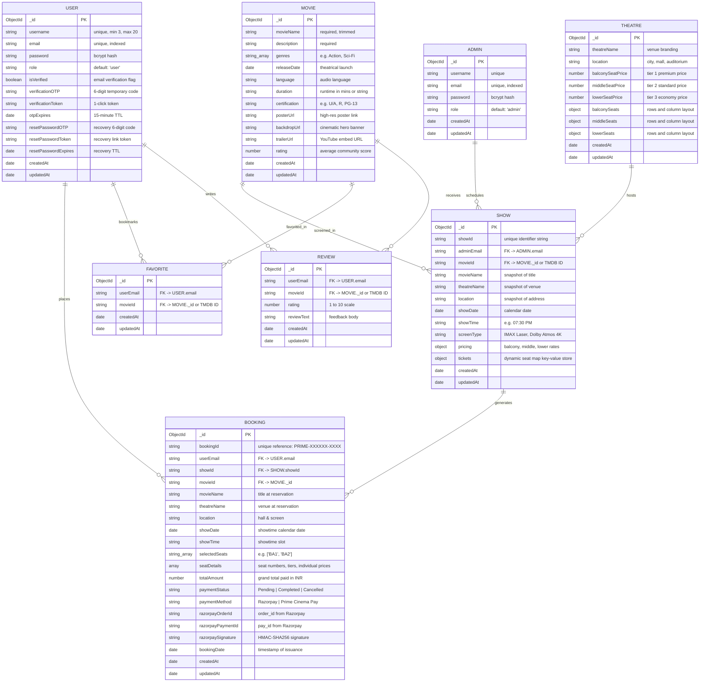

# 📊 Entity-Relationship (ER) Diagram

This document models the database entities, attributes, constraints, and relationships for the **iMovies** cinema ticket booking platform. The system operates on **MongoDB (Mongoose ODM)** with an automated in-memory store fallback.

---

## 📐 Mermaid ER Diagram



---

## 📋 Entity Descriptions & Cardinality Summary

| Parent Entity | Relationship | Child Entity | Cardinality | Business Rule / Description |
| :--- | :--- | :--- | :--- | :--- |
| **`USER`** | Places | **`BOOKING`** | `1 : N` | A registered user can make zero, one, or multiple cinema reservations. Each booking belongs strictly to one verified user. |
| **`USER`** | Bookmarks | **`FAVORITE`** | `1 : N` | Users can curate an Amazon Prime style watchlist. Composite uniqueness ensures no duplicate movie entries per user. |
| **`USER`** | Writes | **`REVIEW`** | `1 : N` | Users can post audience feedback and 1–10 star ratings on any feature film. |
| **`ADMIN`** | Schedules | **`SHOW`** | `1 : N` | Administrators manage screening timetables, screen formats (IMAX, Dolby Atmos), and auditorium pricing tiers. |
| **`MOVIE`** | Screened In | **`SHOW`** | `1 : N` | A single movie title can be scheduled across multiple auditoriums, cities, and time slots simultaneously. |
| **`THEATRE`** | Hosts | **`SHOW`** | `1 : N` | Physical multiplex venues host multiple scheduled shows with specific tier seating geometry. |
| **`SHOW`** | Generates | **`BOOKING`** | `1 : N` | Each scheduled show maintains real-time seat lock state (`available`, `locked`, `booked`) and yields confirmed booking passes. |

---

## 🔒 Dynamic Key-Value Seat Map (`SHOW.tickets`)

Instead of storing hundreds of individual database documents per seat, each `Show` document embeds a dynamic, memory-efficient dictionary structure indexable in $O(1)$ time:

```json
{
  "BA1": {
    "seatNumber": "BA1",
    "tier": "Balcony Club Lounge",
    "price": 300,
    "status": "available",
    "lockedBy": null,
    "lockedUntil": null
  },
  "MB1": {
    "seatNumber": "MB1",
    "tier": "Prime Executive Tier",
    "price": 220,
    "status": "locked",
    "lockedBy": "user@example.com",
    "lockedUntil": "2026-11-01T17:45:00.000Z"
  },
  "LA1": {
    "seatNumber": "LA1",
    "tier": "Lower Standard Saver",
    "price": 150,
    "status": "booked",
    "lockedBy": null,
    "lockedUntil": null
  }
}
```

- **5-Minute TTL Watchdog**: Background intervals sweep through active shows and revert seats whose `lockedUntil < Date.now()` back to `"available"`.
- **Concurrency Protection**: During order initiation and payment verification, atomic checks ensure locked seats cannot be hijacked by competing requests.
