# 🗺️ User Journey & Workflow Diagram

This document illustrates the end-to-end user experience on **iMovies**, tracing interactions from the initial landing page to theatrical movie discovery, real-time seat locking with 5-minute TTL expirations, Razorpay payment processing, and digital ticket delivery via Brevo email.

---

## 🧭 Mermaid User Flow Diagram

```mermaid
flowchart TD
    %% Entry & Authentication Phase
    Start([Visitor Arrives]) --> Landing["Landing Page (/landing)<br/>• Hero Billboard Carousel<br/>• Value Proposition CTAs"]
    Landing --> AuthChoice{"Has Account?"}
    
    AuthChoice -- "No" --> Register["Register (/register)<br/>• Username, Email, Password<br/>• Select Viewer / Admin"]
    Register --> SendOTP["Server generates 6-digit OTP<br/>Brevo sends activation email"]
    SendOTP --> VerifyModal["OTP Verification Modal<br/>• Enter 6 Digits<br/>• Or click 1-Click Token Link"]
    VerifyModal -- "Valid Code" --> SessionActive["Account Activated & JWT Issued"]
    VerifyModal -- "Expired / Invalid" --> ResendCode["Resend OTP Countdown (60s)"]
    ResendCode --> SendOTP

    AuthChoice -- "Yes" --> Login["Login (/login)<br/>• Email & Password Input"]
    Login --> Forgot{"Forgot Password?"}
    Forgot -- "Yes" --> ForgotModal["Forgot Password Modal<br/>• Enter Email -> Send Reset OTP<br/>• Submit Code & New Password"]
    ForgotModal --> Login
    Forgot -- "No" --> CredCheck{"Valid Credentials?"}
    CredCheck -- "No" --> Login
    CredCheck -- "Yes & Verified" --> SessionActive
    CredCheck -- "Yes & Unverified" --> VerifyModal

    %% Exploration Phase
    SessionActive --> Home["Prime Cinema Home (/home)<br/>• TMDB Trending & Now Playing<br/>• Genre Rows & Hero Banner<br/>• Debounced Live Search<br/>• Language & Year Filters"]
    Home --> MovieDetails["Movie Details (/moviedetails/:id)<br/>• High-res Poster & Backdrop<br/>• YouTube Trailer Modal<br/>• Top Billing Cast Avatars<br/>• Community Star Ratings"]
    
    MovieDetails --> WatchlistAction["Watchlist Toggle (/watchlist)"]
    MovieDetails --> BookCTA["Click 'Book Tickets'"]

    %% Show & Seat Selection Phase
    BookCTA --> Showtimes["Movie Shows Page (/movieshows/:id)<br/>• Select Date Tab<br/>• Select Multiplex Venue & Hall<br/>• Choose Showtime Slot"]
    Showtimes --> SeatGrid["Interactive Seat Selector (/seatslug/:showId)<br/>• Balcony Club Lounge (Diamond)<br/>• Prime Executive Tier (Star)<br/>• Lower Standard Saver (Economy)"]
    
    SeatGrid --> PickSeats["Select Desired Seats (Max 8)"]
    PickSeats --> LockAction["Click 'Lock Seats for Checkout'"]
    LockAction --> TTLLock["Server Validates & Locks Seats<br/>• Status: 'locked'<br/>• 5-Minute TTL Timer Starts"]
    
    TTLLock --> TTLCheck{"Seats Conflict or Timeout?"}
    TTLCheck -- "Conflict / Timeout" --> AutoRelease["Seats Auto-Released<br/>Notification Displayed"]
    AutoRelease --> SeatGrid

    %% Checkout & Payment Phase
    TTLCheck -- "Lock Secured" --> CheckoutModal["Checkout & Payment Modal<br/>• Ticket Breakdown & Discount<br/>• Convenience Fees<br/>• Choose Payment Method"]

    CheckoutModal --> PayChoice{"Payment Gateway Selection"}
    
    PayChoice -- "Prime 1-Click Pay" --> OneClick["POST /api/bookings/confirm-booking<br/>Instant Wallet / Credit Pass"]
    
    PayChoice -- "Razorpay Secure" --> RzpOrder["POST /api/payment/create-order<br/>• Convert INR to Paise<br/>• Returns order_id & key_id"]
    RzpOrder --> RzpModal["Razorpay Checkout Window<br/>• UPI (GPay, PhonePe, Paytm, QR)<br/>• Cards (Visa, MC, RuPay)<br/>• NetBanking & Wallets"]
    
    RzpModal -- "User Cancels / Closes" --> KeepHold["Seats retained under 5-min TTL<br/>User may retry payment"]
    KeepHold --> CheckoutModal

    RzpModal -- "Payment Authorized" --> RzpVerify["POST /api/payment/verify<br/>• Cryptographic HMAC-SHA256 Match<br/>• order_id + payment_id verified"]

    RzpVerify -- "Invalid Signature" --> TamperReject["Reject (HTTP 400)<br/>Release Seats Immediately"]
    TamperReject --> SeatGrid

    %% Completion Phase
    OneClick --> FinalizePass["Finalize Booking in MongoDB<br/>• Mark tickets status: 'booked'<br/>• Generate Booking Reference ID"]
    RzpVerify -- "Verified Signature" --> FinalizePass

    FinalizePass --> BrevoTicket["Brevo Transactional Email Engine<br/>• Dispatches Digital Pass to Inbox<br/>• Embedded Entry Gate Barcode"]
    FinalizePass --> BookingSuccess["Redirect to Bookings (/bookings)<br/>• Digital Perforated Pass View<br/>• Real-time Reservation Status<br/>• Print & Download Ticket Pass"]

    BookingSuccess --> PostReview["Review & Rating Submission<br/>POST /api/review"]
    BookingSuccess --> CancelHold{"User Requests Cancellation?"}
    CancelHold -- "Yes" --> ReleaseRefund["PUT /api/bookings/cancel/:id<br/>• Status: 'Cancelled'<br/>• Seats returned to available inventory<br/>• Cancellation email sent via Brevo"]
    CancelHold -- "No" --> EnjoyMovie([Attend Cinema Gate & Enjoy Film])
```

---

## 🎬 Key Stage Breakdown

### 1. Account Onboarding & Email Verification
- Every new user registration requires email authentication.
- Users receive an Amazon Prime styled transactional email with a prominent **6-digit numerical OTP** and a 1-click token activation link.
- Unverified users attempting to log in are gracefully intercepted, issued a fresh OTP, and presented with an inline input modal.
- Includes a self-service password recovery loop with timed OTP tokens.

### 2. Film Discovery & Showtime Scheduling
- Real-time catalog populated from **The Movie Database (TMDB) API v3** combined with local blockbuster seed databases.
- Multi-faceted dynamic filtering by genre classification, spoken audio language, and release year.
- Venue selection grouped by multiplex branding (e.g., *Miraj IMAX*, *PVR Director's Cut*, *Cinepolis 4DX*) with multi-day calendar tabs.

### 3. Real-Time Seat Allocation & 5-Minute TTL
- Tier-based cinema geometry mapping:
  - 💎 **Balcony Club Lounge**: Premium reclining seats with luxury amenities.
  - ⭐ **Prime Executive Tier**: Centered panoramic rows.
  - 🎟️ **Lower Standard Saver**: Value seating rows.
- Dynamic seat states:
  - 🟢 **Available**: Selectable by the customer.
  - 🔵 **Selected / Locked by You**: Highlighted in cyan `#00a8e1` with active countdown clock.
  - 🟡 **Locked by Another Customer**: Amber badge with lock icon preventing collision.
  - 🔴 **Booked**: Disabled and grayed out.

### 4. Dual Payment Processing
- **Razorpay (Test Mode)**:
  - Amount converted to smallest currency unit (paise: ₹1 = 100 paise).
  - Multi-method support: UPI QR codes, Google Pay, PhonePe, credit/debit cards, net banking.
  - Verification via backend HMAC-SHA256 signature calculation preventing replay and tampering attacks.
- **Prime Cinema 1-Click Pay**: Instant zero-friction pass generation for internal credits and testing.

### 5. Fulfillment & Digital Ticket Pass
- Immediate asynchronous dispatch of the digital ticket pass via Brevo with booking metadata, auditorium hall, seat designations, and entry gate barcode.
- Dedicated `/bookings` page supporting physical pass printing via standard browser print dialogs (`window.print()`).
