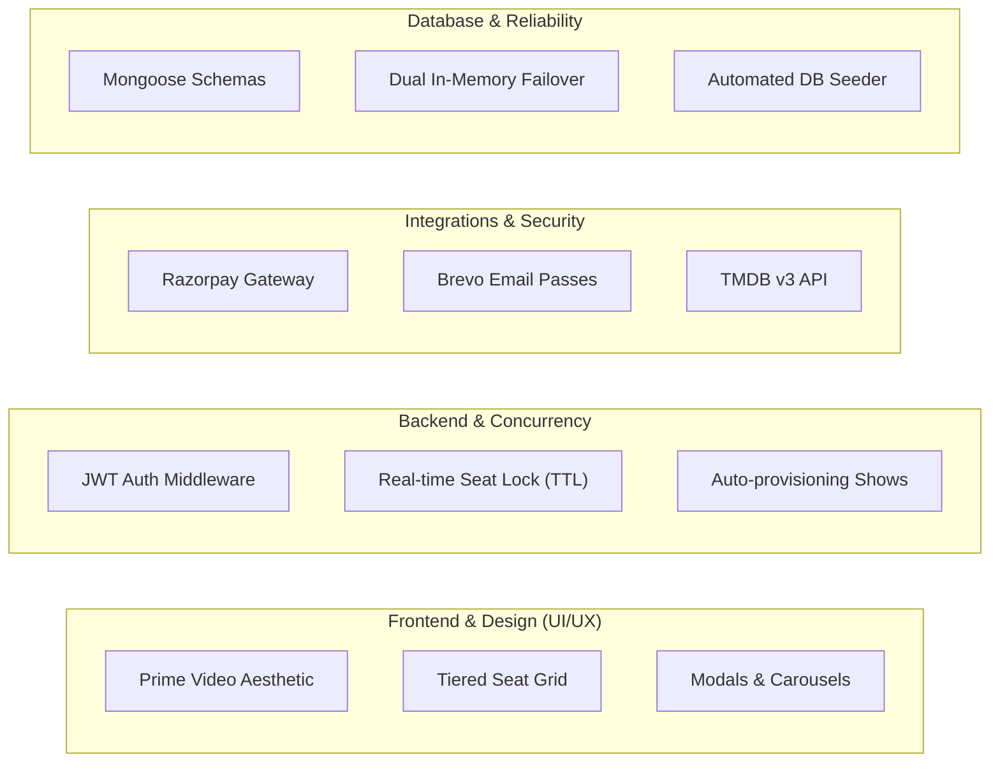

# 👥 Team Roles & Responsibilities

This document defines the team structure, core responsibilities, module assignments, and engineering workflows for the **iMovies** movie ticket booking platform.

---

## 📋 Team Contribution Breakdown Table

| Role Title | Focus Area | Core Modules & Responsibilities | Key Technologies & Deliverables |
| :--- | :--- | :--- | :--- |
| **Principal Full-Stack Architect** | System Design & Full-Stack Orchestration | • End-to-end architecture design and repository structure. • Integration of MVC pattern across Client and Server. • CI/CD, Git versioning, and environment management. | Node.js, Express, React, Vite, Git, GitHub Actions |
| **Lead Frontend & UI/UX Engineer** | Client Application & Design System | • Implementation of **Amazon Prime Video dark aesthetic** (`#0f171e`, `#1a242f`, `#00a8e1`). • Responsive movie carousel sliders, hero billboard banner, and cinema screen curvature. • Interactive 3-tier seat grid selector (Balcony, Middle, Lower). • Modal dialogs (OTP authentication, password reset, trailers). | React.js, Tailwind CSS, Lucide Icons, React-Toastify, Axios |
| **Senior Backend & API Engineer** | REST API & Domain Logic | • Development of modular Express REST controllers and route handlers. • Implementation of JWT authentication and role-based guards (`verifyToken`, `verifyAdmin`). • Automatic show scheduling, auditorium allocation, and movie CRUD APIs. | Express.js, JWT, bcrypt.js, Node.js REST APIs |
| **Database & Concurrency Specialist** | Data Modeling & Real-Time Locks | • Design of Mongoose schemas (User, Admin, Movie, Theatre, Show, Booking, Reviews, Favorites). • Engineering of real-time seat locking with **5-Minute TTL** expiration. • Dual-persistence failover: MongoDB ODM with automatic in-memory persisted fallback (`memoryStore.js`). | MongoDB, Mongoose, Memory Datastore, Concurrency Controls |
| **Payments & Integrations Engineer** | Financial Transactions & Security | • Full **Razorpay Payment Gateway (Test Mode)** integration. • Cryptographic HMAC-SHA256 signature verification preventing payment tampering. • Seamless transition of seat status from `locked` to `booked` upon payment success. | Razorpay Node.js SDK, Checkout.js, Node `crypto` |
| **Communications & Security Specialist** | Transactional Messaging & Auth | • Complete **Brevo (Sendinblue)** transactional email integration. • Mandatory 6-digit email OTP verification for new registrations. • Automated dispatch of digital cinema passes with entry gate barcodes. • Secure self-service password recovery flow with timed tokens. | `@getbrevo/brevo` SDK, Brevo SMTP REST API, Nodemailer |
| **QA & Verification Engineer** | Automated Testing & Documentation | • Development of end-to-end automated test suites (`test-runner.js`, `test-razorpay.js`, `test-brevo.js`, `test-auth-otp.js`). • Architectural documentation, ER diagrams, and user flow workflows. | Node Test Scripts, Mermaid.js, Markdown Docs |

---

## 🎯 Detailed Module Ownership

### 1. User Authentication & Verification Flow
- **Owner**: Communications & Security Specialist + Senior Backend Engineer
- **Responsibilities**:
  - Implement bcrypt password hashing (10 salt rounds).
  - Issue 6-digit random numeric OTPs with a 15-minute expiration timestamp upon registration.
  - Enforce email verification check on `/api/auth/login`; unverified accounts receive `403 Forbidden` with automated OTP re-dispatch.
  - Maintain the `/verify-otp`, `/resend-otp`, `/forgot-password`, and `/reset-password` endpoints.

### 2. Real-Time Seat Allocation & TTL Concurrency
- **Owner**: Database & Concurrency Specialist
- **Responsibilities**:
  - Model seat layout using an $O(1)$ key-value structure inside the `Show` schema.
  - Implement atomic seat holding (`POST /api/bookings/lock-seats`) with conflict detection (HTTP 409).
  - Maintain the background watchdog (`ttlCleaner.js`) running every 15 seconds to release abandoned reservations.

### 3. Payment Gateway Lifecycle
- **Owner**: Payments & Integrations Engineer
- **Responsibilities**:
  - Maintain backend order creation (`POST /api/payment/create-order`) converting INR to paise.
  - Configure the frontend Razorpay Checkout modal supporting UPI, Credit/Debit cards, NetBanking, and Wallets.
  - Verify HMAC-SHA256 signatures server-side before persisting confirmed tickets.
  - Release locked seats immediately upon payment cancellation or signature failure.

### 4. Movie Catalog & TMDB API Enrichment
- **Owner**: Lead Frontend & UI/UX Engineer + Senior Backend Engineer
- **Responsibilities**:
  - Integrate official TMDB API v3 endpoints for live Trending, Now Playing, and Search feeds.
  - Build responsive movie cards with high-res posters (`w500`) and hero backdrops (`original`).
  - Provide an in-app TMDB status and API key configuration modal.

---

## 📐 Engineering Guidelines & Standards

1. **Git & Commit Hygiene**:
   - Write clear, imperative commit messages (`feat:`, `fix:`, `docs:`, `refactor:`, `test:`).
   - Never commit raw `.env` files or active API secrets into public version control. Keep `.env.example` up to date.

2. **Code Quality & Error Handling**:
   - All controller methods must be wrapped in `try-catch` blocks and return standardized JSON envelopes.
   - External API calls (TMDB, Razorpay, Brevo) must have graceful fallbacks and structured error logging.

3. **Design Consistency**:
   - Maintain strict adherence to the **Amazon Prime Video Dark Theme** (`#0f171e`, `#1a242f`, `#00a8e1`) across all pages, modals, and emails.
